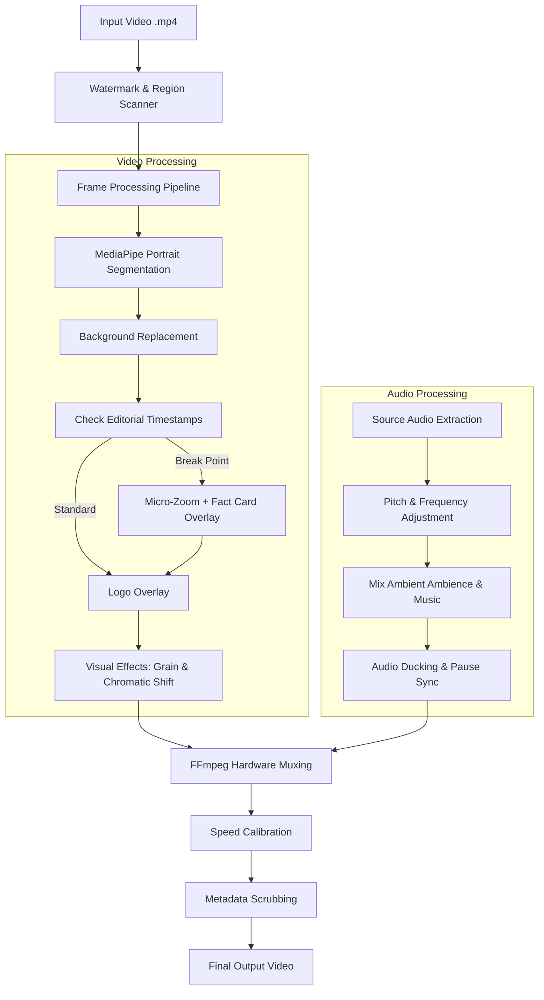

# YTeX – Automated Video Enhancement & Processing Pipeline

A desktop application and automated video processing pipeline designed to transform, composite, and enhance video clips with AI-driven subject isolation, dynamic editorial overlays, and custom audio mixing.

---

## Features

- **AI Subject Isolation & Background Compositing**: Utilizes MediaPipe for portrait segmentation, extracting foreground subjects and compositing them onto custom backgrounds with drop shadows.
- **Smart Watermark Detection & Branding Inpainting**: Scans early video frames using morphological contour analysis to detect overlay artifacts and seamlessly applies channel branding over target areas.
- **Editorial Narrative Engine**: Inserts customizable freeze-frame commentary breaks with subtle camera micro-zooms ($1.0\times \to 1.1\times$), background blur, and animated pop-up text cards.
- **Visual Effects & Processing**: Applies procedural film grain, chromatic aberration shifts, and dynamic camera movement to create polished, high-quality exports.
- **Audio Engineering & Layering**: Combines original audio with background music, environmental soundscapes, audio ducking, speed scaling, and pitch adjustments.
- **Metadata Scrubbing**: Cleans existing media container tags and applies standardized creation profiles.
- **Desktop Batch Processing**: Modern desktop GUI built with CustomTkinter supporting queue management for batch workflows.

---

## System Architecture



---

## Installation

### Prerequisites

- **Python**: 3.10 or higher
- **FFmpeg**: Required for media encoding (managed via `imageio-ffmpeg` or system installation)

### Steps

1. **Clone the repository:**
   ```bash
   git clone https://github.com/RiyanRajak25/YTeX.git
   cd YTeX
   ```

2. **Create a virtual environment:**
   ```bash
   python -m venv venv
   # On Windows:
   .\venv\Scripts\activate
   # On macOS/Linux:
   source venv/bin/activate
   ```

3. **Install dependencies:**
   ```bash
   pip install -r requirements.txt
   ```

---

## Usage

### Launching the Application

Run the graphical interface:
```bash
python main.py
```

### Queue Workflow

1. Click **Select Video (MP4)** to pick an input video.
2. (Optional) Paste transcript text containing editorial pause tags in the format:
   ```text
   [MM:SS | TITLE | Content description]
   ```
   **Examples:**
   ```text
   [00:10 | DID YOU KNOW? | This technique was first introduced in modern production workflows.]
   [00:25 | KEY INSIGHT | Consistent lighting is crucial for clean background segmentation.]
   ```
3. Click **Add to Queue** to stage the job (up to 10 jobs per batch).
4. Select the destination folder via **Select Output Folder**.
5. Click **Start Processing All** to process the queue.

---

## Project Structure

```
YTeX/
├── assets/
│   ├── ambient/            # Ambient audio tracks (.mp3, .wav)
│   ├── backgrounds/        # Background images (.png, .jpg)
│   ├── logos/              # Watermark overlay images (.png, .jpg)
│   └── music/              # Background music tracks (.mp3, .wav)
├── core/
│   ├── __init__.py
│   ├── audio.py            # Audio processing, mixing, and ducking
│   ├── editorial.py        # Animated editorial cards and text overlays
│   ├── effects.py          # Procedural grain, zoom, and chromatic effects
│   ├── processor.py        # Core pipeline coordinator and video assembly
│   ├── utils.py            # Metadata scrubbing and formatting utilities
│   ├── vision.py           # Segmentation models and background replacement
│   └── models/
│       └── selfie_segmenter.tflite # Local segmentation model
├── main.py                 # CustomTkinter desktop interface
├── requirements.txt        # Python package requirements
├── .gitignore              # Git ignore rules
└── README.md               # Documentation
```

---

## Assets Configuration

- **Backgrounds**: Add custom images to `assets/backgrounds/`.
- **Logos**: Add branding images to `assets/logos/` to mask detected overlay watermarks.
- **Audio**: Add audio files to `assets/music/` and `assets/ambient/` for multi-track soundscapes.

---

## License

This project is licensed under the MIT License.
